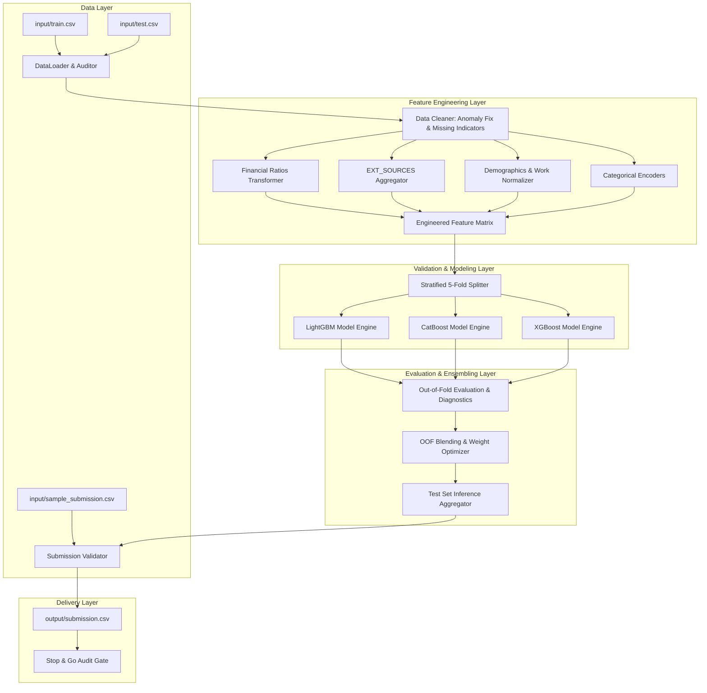

# 02 — Arquitectura del Sistema y Reglas de Dependencias

## 1. Diagrama de Arquitectura y Flujo de Datos



---

## 2. Componentes del Sistema

1. **`src/data/` (Data Loading & Auditing):** Carga los datasets crudos, valida tipos y produce el reporte inicial de sanidad y anomalías.
2. **`src/features/` (Feature Engineering):** Contiene transformadores puros de scikit-learn o clases modulares para construir ratios, interacciones y encodings sin introducir fuga de datos.
3. **`src/models/` (Model Training Engines):** Clases adaptadoras para LightGBM, CatBoost y XGBoost que entrenan sobre cada fold con *early stopping* sobre la métrica ROC-AUC.
4. **`src/ensemble/` (Blending & Calibration):** Ponderación y promedio de predicciones OOF y de test.
5. **`src/utils/` (Validation & Metrics):** Métricas de evaluación, verificación de contratos de submission y registro de auditoría.

---

## 3. Estructura del Repositorio y Reglas de Importación

### Estructura de Directorios
```
Competition/
├── docs/                      # Especificación completa (00 a 10)
│   ├── contracts/             # Contratos de datos e interfaz CLI
├── implementation/            # Planes ejecutables de tareas (S0-T1, etc.)
├── input/                     # Datasets originales inmutables
│   ├── train.csv
│   ├── test.csv
│   └── sample_submission.csv
├── output/                    # Archivos de submission y predicciones OOF
│   ├── submission.csv
│   └── oof_predictions.csv
├── src/                       # Código fuente modular
│   ├── __init__.py
│   ├── data/                  # Carga, auditoría y limpieza
│   ├── features/              # Ingeniería de variables
│   ├── models/                # Entrenadores de LightGBM, CatBoost, XGBoost
│   ├── ensemble/              # Blending y ponderación
│   └── utils/                 # Métricas, verificación de submission y semillas
└── tests/                     # Tests unitarios y de contrato (TDD)
```

### Reglas de Dependencias entre Capas (Import Rules)
1. **`src/utils`:** Es la capa base. No puede importar de ningún otro módulo interno de `src/`.
2. **`src/data`:** Puede importar de `src/utils`. No puede importar de `features`, `models` ni `ensemble`.
3. **`src/features`:** Puede importar de `src/utils` y `src/data`. No puede importar de `models` ni `ensemble`.
4. **`src/models`:** Puede importar de `src/features`, `src/data` y `src/utils`. No puede importar de `ensemble`.
5. **`src/ensemble`:** Puede importar de `src/models`, `src/features` y `src/utils`.
6. **`input/`:** Es estrictamente de **sólo lectura**. Ningún script puede modificar o sobreescribir archivos en `input/`.

---

## 4. Trazabilidad: Requerimiento → Tarea → Test

| Requerimiento (MoSCoW) | Tarea de Implementación | Test Asociado | Criterio de Aceptación |
|---|---|---|---|
| **REQ-M01** (CV Estratificado) | `S1-T1-cv-pipeline` | `tests/test_validation.py` | 5 folds con distribución balanceada de `TARGET` (ratio idéntico en cada fold $\pm 0.1\%$). |
| **REQ-M02** (Baseline LightGBM) | `S1-T2-baseline-lightgbm` | `tests/test_models.py` | OOF ROC-AUC $\ge 0.7450$, predicciones completas para 171,202 filas train y 61,500 test. |
| **REQ-M03** (Anomalía Empleo) | `S0-T1-data-audit` | `tests/test_cleaning.py` | Valor 365243 convertido a `np.nan`; `DAYS_EMPLOYED_ANOM` binario (0 o 1). |
| **REQ-M04** (Ratios Financieros) | `S2-T1-domain-ratios` | `tests/test_features.py` | Ratios calculados sin división por cero; correlación esperada con `TARGET`. |
| **REQ-M05** (Interacciones EXT) | `S2-T2-ext-sources-interactions` | `tests/test_features.py` | Estadísticas agregadas (`MEAN`, `STD`, `PROD`) calculadas correctamente. |
| **REQ-M06** (Verificación Sub) | `S5-T1-submission-audit` | `tests/test_submission_contract.py` | Exactamente 61,500 filas, cabeceras `SK_ID_CURR,TARGET`, valores en $[0.0, 1.0]$. |
| **REQ-M07** (Stop & Go Gates) | Todas las tareas de Sprint | Logs de auditoría | Checkpoint documentado y validado antes de proceder. |
| **REQ-S01** (CatBoost & XGBoost)| `S3-T1`, `S3-T2` | `tests/test_models.py` | Modelos entrenados sobre los mismos 5 folds con OOF ROC-AUC $\ge 0.7500$. |
| **REQ-S02** (Ensemble Blending) | `S4-T1-blending-optimizer` | `tests/test_ensemble.py` | OOF ROC-AUC Blended superior a cualquier modelo individual en al menos $+0.0020$. |
